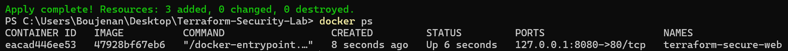
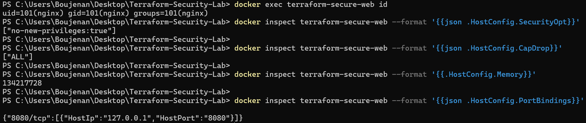
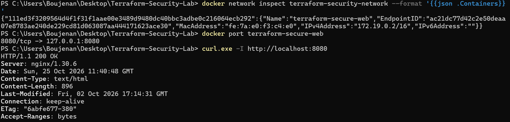
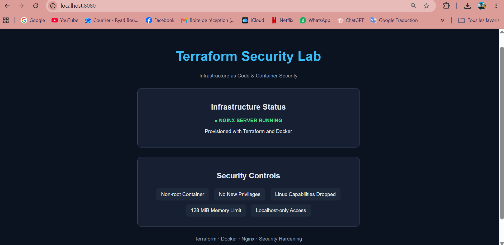
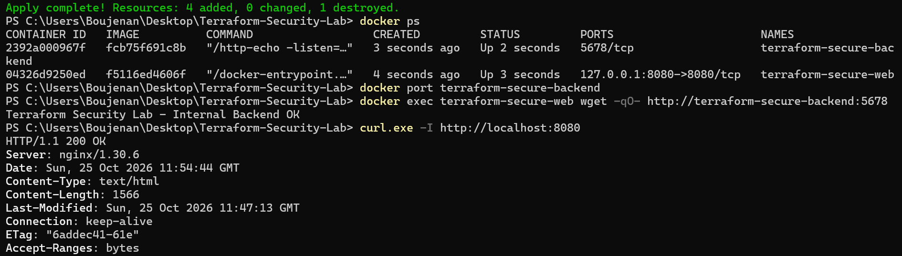
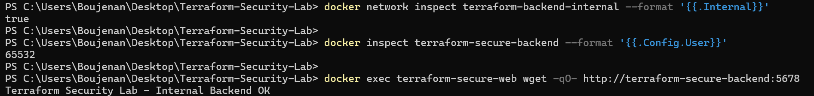

# 🔐 Terraform Security Lab

### Secure Infrastructure as Code | Docker Hardening | Network Segmentation

A hands-on cybersecurity project demonstrating how to deploy, secure, and validate a containerized infrastructure using **Terraform and Docker**.

The infrastructure consists of a hardened Nginx frontend and an isolated HTTP backend, provisioned entirely through Infrastructure as Code (IaC).

> **Environment:** Windows 11 · Terraform · Docker Desktop · Linux Containers
> **Cost:** 100% free — no AWS account or cloud subscription required.

---

## 🎯 Project Objectives

* Automate infrastructure deployment using Terraform.
* Apply container security hardening and least-privilege principles.
* Run frontend and backend services as non-root users.
* Restrict Linux capabilities and privilege escalation.
* Implement network segmentation between application components.
* Prevent direct host-port exposure of internal services.
* Validate security controls through practical tests.

---

## 🏗️ Infrastructure Architecture

```text
                    WINDOWS HOST
                         |
                  127.0.0.1:8080
                         |
                         v
              +---------------------+
              |   NGINX FRONTEND    |
              |---------------------|
              | UID: 101 (non-root) |
              | Memory: 128 MiB     |
              | Capabilities: NONE  |
              | No New Privileges   |
              +----------+----------+
                         |
                         |
             INTERNAL DOCKER NETWORK
             terraform-backend-internal
                         |
                         v
              +---------------------+
              |    HTTP BACKEND     |
              |---------------------|
              | UID: 65532         |
              | Memory: 64 MiB      |
              | Capabilities: NONE  |
              | No Published Ports  |
              +---------------------+
```

### Network Design

The infrastructure uses two Docker networks:

| Network                      | Purpose                           | Configuration            |
| ---------------------------- | --------------------------------- | ------------------------ |
| `terraform-security-network` | Frontend network                  | Dedicated Docker network |
| `terraform-backend-internal` | Frontend-to-backend communication | `internal = true`        |

**Frontend:**

* Connected to both networks.
* Accessible from the Windows host through `127.0.0.1:8080`.
* Runs an unprivileged Nginx image.

**Backend:**

* Connected exclusively to the internal network.
* Has no published host ports.
* Communicates with the frontend using Docker's internal DNS.

This architecture reduces unnecessary service exposure. It does not imply complete isolation from the Docker host.

---

## 🛡️ Security Controls

| Security Control                | Implementation           | Verification                     |
| ------------------------------- | ------------------------ | -------------------------------- |
| Non-root frontend               | UID `101`                | `docker exec ... id`             |
| Non-root backend                | UID `65532`              | `docker inspect ... Config.User` |
| Privilege escalation protection | `no-new-privileges:true` | Docker inspection                |
| Linux capabilities restriction  | Drop `ALL`               | Docker inspection                |
| Frontend memory limit           | 128 MiB                  | Docker inspection                |
| Backend memory limit            | 64 MiB                   | Terraform configuration          |
| Restricted frontend exposure    | `127.0.0.1:8080`         | Docker port inspection           |
| Internal backend network        | `internal = true`        | Docker network inspection        |
| Backend port exposure           | No published ports       | `docker port`                    |
| Read-only HTML mount            | `read_only = true`       | Terraform configuration          |

### Security Principles Applied

**Least Privilege:** Services run without root privileges and with Linux capabilities removed.

**Defense in Depth:** Multiple controls reduce the impact of potential compromise.

**Network Segmentation:** Internal application communication uses a dedicated Docker network.

**Reduced Attack Surface:** The backend is not exposed through a host port.

**Infrastructure as Code:** Security controls are defined declaratively and can be reproduced.

---

## 🧰 Technologies Used

| Technology          | Role                                                 |
| ------------------- | ---------------------------------------------------- |
| Terraform           | Infrastructure provisioning and lifecycle management |
| Docker Desktop      | Container runtime                                    |
| Nginx Unprivileged  | Hardened web frontend                                |
| HashiCorp HTTP Echo | Lightweight backend service                          |
| PowerShell          | Deployment and security validation                   |
| Git / GitHub        | Version control and project documentation            |

---

## 📂 Project Structure

```text
terraform-security-lab/
├── main.tf
├── .terraform.lock.hcl
├── .gitignore
├── README.md
├── web/
│   └── index.html
├── screenshots/
│   ├── 01_Terraform_Infrastructure_Deployed.png
│   ├── 02_Container_Security_Controls.png
│   ├── 03_Network_Configuration.png
│   ├── 04_Secure_Web_Server.png
│   ├── 05_Backend_Network_Isolation.png
│   └── 06_Internal_Network_Security.png
└── docs/
```

Terraform state files and provider binaries are excluded from version control.

---

## 🚀 Deployment Guide

### Prerequisites

* Windows 11
* Docker Desktop running Linux containers
* Terraform CLI
* PowerShell

### 1. Clone the repository

```powershell
git clone https://github.com/Ryad-Cyber/terraform-security-lab.git
cd terraform-security-lab
```

### 2. Initialize Terraform

```powershell
terraform init
```

Downloads the required Terraform Docker provider.

### 3. Validate the configuration

```powershell
terraform fmt -check
terraform validate
```

### 4. Review the deployment plan

```powershell
terraform plan
```

### 5. Deploy the infrastructure

```powershell
terraform apply
```

Confirm by typing `yes`.

### 6. Verify running containers

```powershell
docker ps
```

Expected containers:

```text
terraform-secure-web
terraform-secure-backend
```

### 7. Access the frontend

Open your browser:

**http://localhost:8080**

The customized **Terraform Security Lab** dashboard should appear.

---

## 🧪 Security Validation

The following tests were performed to verify the infrastructure security configuration.

### Test 1 — Non-root Execution

**Frontend:**

```powershell
docker exec terraform-secure-web id
```

Result:

```text
uid=101(nginx) gid=101(nginx) groups=101(nginx)
```

**Backend:**

```powershell
docker inspect terraform-secure-backend --format '{{.Config.User}}'
```

Result:

```text
65532
```

**Status:** PASS — Both services run as non-root users.

### Test 2 — Privilege Escalation Protection

```powershell
docker inspect terraform-secure-web --format '{{json .HostConfig.SecurityOpt}}'
```

Result:

```text
["no-new-privileges:true"]
```

**Status:** PASS

### Test 3 — Linux Capabilities Restriction

```powershell
docker inspect terraform-secure-web --format '{{json .HostConfig.CapDrop}}'
```

Result:

```text
["ALL"]
```

**Status:** PASS

### Test 4 — Memory Restriction

```powershell
docker inspect terraform-secure-web --format '{{.HostConfig.Memory}}'
```

Result:

```text
134217728
```

This corresponds to **128 MiB**.

**Status:** PASS

### Test 5 — Internal Network Configuration

```powershell
docker network inspect terraform-backend-internal --format '{{.Internal}}'
```

Result:

```text
true
```

**Status:** PASS

### Test 6 — Backend Exposure

```powershell
docker port terraform-secure-backend
```

Result:

```text
No output
```

The backend has no published host ports.

**Status:** PASS

### Test 7 — Frontend-to-Backend Communication

```powershell
docker exec terraform-secure-web wget -qO- http://terraform-secure-backend:5678
```

Result:

```text
Terraform Security Lab - Internal Backend OK
```

**Status:** PASS

### Test 8 — Frontend Availability

```powershell
curl.exe -I http://localhost:8080
```

Result:

```text
HTTP/1.1 200 OK
```

**Status:** PASS

---

## 📸 Screenshots & Evidence

### 01 — Automated Infrastructure Deployment



Terraform provisions the infrastructure and manages Docker resources.

### 02 — Container Security Controls



Verification of non-root execution, privilege restrictions, memory limits, and localhost-only port binding.

### 03 — Docker Network Configuration



Verification of the dedicated Docker network and restricted frontend exposure.

### 04 — Customized Security Dashboard



Customized Nginx frontend presenting the infrastructure and its configured security controls.

### 05 — Backend Network Isolation



Demonstration of frontend-to-backend communication without publishing the backend port on the host.

### 06 — Internal Network Security



Verification of the internal Docker network and backend non-root execution.

---

## ♻️ Infrastructure Lifecycle

Terraform manages the infrastructure throughout its lifecycle.

| Command              | Purpose                        |
| -------------------- | ------------------------------ |
| `terraform init`     | Initialize the project         |
| `terraform validate` | Validate configuration         |
| `terraform plan`     | Preview infrastructure changes |
| `terraform apply`    | Deploy or update resources     |
| `terraform destroy`  | Remove managed resources       |

To remove the lab:

```powershell
terraform destroy
```

This removes the Terraform-managed infrastructure. It does not delete unrelated Docker containers.

---

## 📚 Key Learnings

Through this project, I gained practical experience in:

* Provisioning Docker infrastructure using Terraform.
* Understanding declarative infrastructure management.
* Applying least-privilege principles to containers.
* Configuring non-root container execution.
* Restricting Linux capabilities and privilege escalation.
* Implementing frontend/backend network segmentation.
* Limiting service exposure to the host.
* Validating security controls using Docker CLI commands.
* Documenting infrastructure security with reproducible evidence.

---

## ⚠️ Scope & Limitations

This is a **local security lab**, not a production deployment.

* No AWS infrastructure was deployed.
* No public internet-facing service was configured.
* Docker network segmentation does not guarantee complete isolation.
* Container hardening reduces risk but does not eliminate vulnerabilities.
* Additional production controls would include image scanning, secrets management, centralized logging, monitoring, and automated security testing.

---

## 👤 Author

**Ryad Boujenan**

Cybersecurity Engineering Student — EMSI Casablanca

Focus: **Cloud Security · SOC / Blue Team · Infrastructure Security**

**Portfolio:** https://ryad-cyber.github.io/

**GitHub:** https://github.com/Ryad-Cyber
